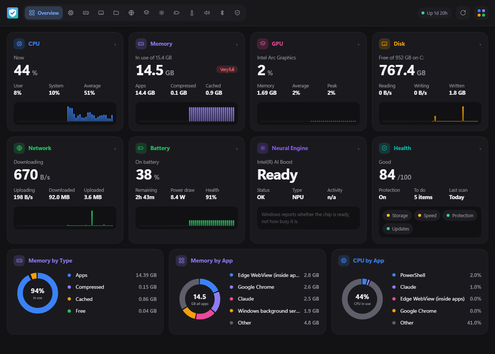
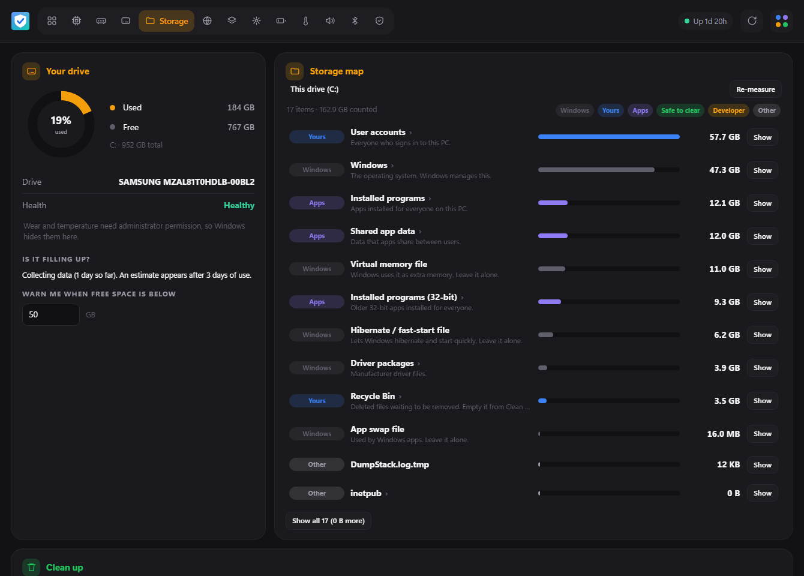
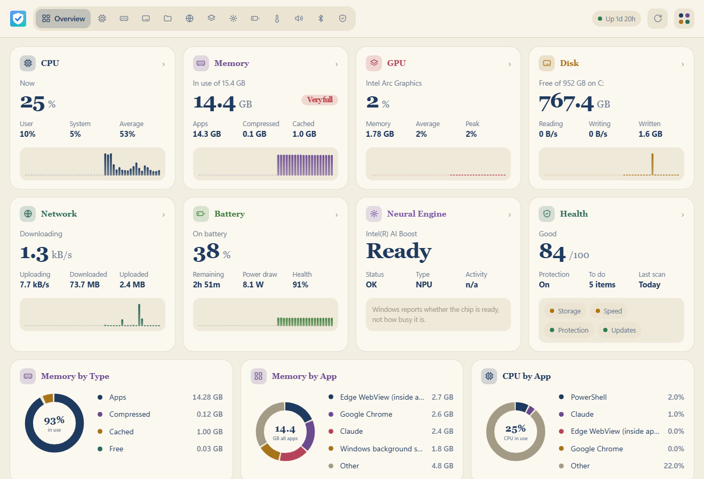

# PC Health Dashboard

A live health, storage and security dashboard for Windows 10/11, in its own app window. Built for people who
are not technical: every finding comes with a plain-English "what to do".



## Screenshots
**Storage map and cleanup** (every folder sized and labelled, click to drill in):



**Paper theme** (there are eight themes, plus one that matches your wallpaper):



## What it does
- **Live dashboard** with CPU, memory, GPU, disk, network and battery cards, bar charts, and per-app usage.
- **Tabs:** Overview, CPU, Memory, Disk, Storage, Network, GPU, Neural (NPU), Battery, Thermals, Sound,
  Bluetooth, Security.
- **Health score** out of 100, with a "what to do" list.
- **Virus protection check:** reads Microsoft Defender (on/off, definitions age, last scan, firewall, threats) and
  can start a Defender quick scan. It does not replace your antivirus; it makes sure it is working.
- **Storage tab:** a storage map (every folder sized, labelled Windows / Yours / Apps / Safe to clear /
  Developer, click to drill in), cleanup of caches and old build files **one item at a time with a
  confirmation**, drive health, a "full in about N days" estimate and your own low-space warning.
- **Themes:** Vitals, Terminal, Amber, Midnight, Plum, Neon, Champagne, Paper, plus **Match my wallpaper**.
- **Weekly check:** optional scheduled task that writes an HTML report and shows a notification.

## Requirements
Windows 10 or 11, Windows PowerShell 5.1 (built in), and Microsoft Edge (preinstalled) or Chrome.
No installer, no dependencies, nothing to download.

## Quick start
```powershell
git clone https://github.com/Vivikta15/pc-health-dashboard.git
cd pc-health-dashboard
.\Make-Icon.ps1            # draws the app icon (once)
.\Create-Shortcuts.ps1     # puts "PC Health" and friends on your Desktop
```
Then double-click **PC Health** on the Desktop. To pin it: right-click > Show more options > Pin to taskbar.

Command line tools (run from the folder): `pchealth health`, `pchealth storage`, `pchealth security -Scan`,
`pchealth report -Open`, `pchealth clean` (dry run) / `pchealth clean -Apply`.

Weekly report and notification: `.\Install-Schedule.ps1` (remove with `-Remove`).

## Privacy and safety
- The dashboard runs a tiny web server on **127.0.0.1 only** (this PC), protected by a one-time secret token and
  a Host-header check. It sends **nothing** anywhere and has no telemetry.
- Your wallpaper (for the wallpaper theme) is read locally and shown only inside the window.
- Nothing is deleted without confirmation. Cleanup only touches a fixed list of cache/temp folders (never paths
  supplied by the page), skips OneDrive cloud-only files, and leaves Windows' own files alone. Big files, old
  downloads and duplicates are only listed; you delete them yourself.
- Reports in `reports\` contain your computer name and file paths, so they are git-ignored.
- Some details (SSD wear/temperature, Windows Update cache, Windows temp) need an administrator PowerShell.
- **Use at your own risk.** Review what a cleanup item does before confirming. See the LICENSE.

## How it is built
| File | Role |
|---|---|
| `PCHealth.ps1` | The checks (health, security, storage), a fast C# folder scanner, cleanup definitions, CLI |
| `Dashboard.ps1` | Local-only HTTP server, live metrics, background tasks, API |
| `dashboard.html` | The whole UI (HTML/CSS/JS, no external libraries), themes, charts |
| `Make-Icon.ps1` | Draws the app icon at every size Windows uses |
| `Create-Shortcuts.ps1`, `Install-Schedule.ps1`, `pchealth.cmd` | Shortcuts, weekly task, launcher |

## Limits
Windows does not report NPU activity, exact CPU temperature or fan speed on most laptops, so those pages say so
instead of showing made-up numbers.

## License
MIT. See [LICENSE](LICENSE).
